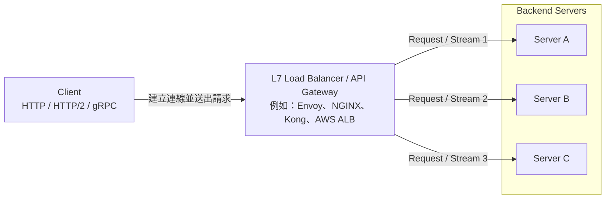

# 微服務LB用長連線
初次接觸微服務的架構  
為了做到流量分配, 以前都覺得一定是要短連線  
每次都讓LB去分配連線結果**效能一個爆炸爛**  

當初想法是走長連線, LB在一開始連線就分配好了  
所以連上後就固定著不會再改  
結果完全不是這樣  
在Client 與 Server之間可以多架一層L7(Envoy、Gateway)等類型的服務  

還是可以做到長連線的LB, 只是沒有一定的完美解  
因為LB這台其實是靠自己把Server與Client通通用長連線連著    
但還是有一些案例需要特殊處理  
例如Server跟LB之間可能是靠心跳機制檢查對方是否還在線, 該機制往往又伴隨時間差問題  
並不保證client一定能順利送達或收到回覆  
只能說被自己的觀念綁架, 限制了想像力